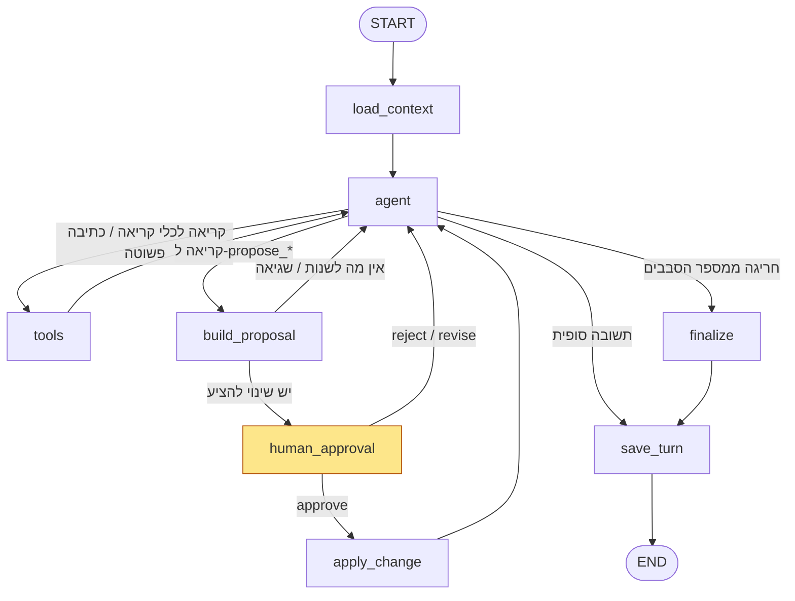
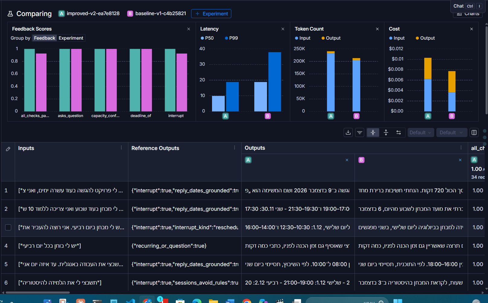
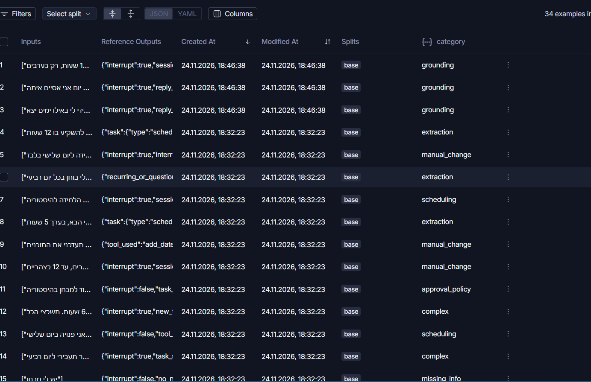
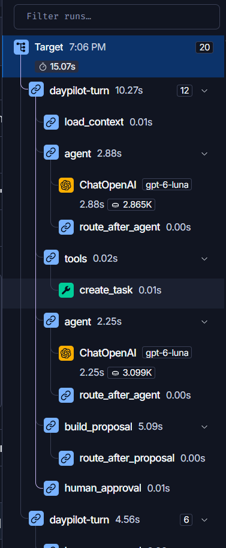

# DayPilot – אגנט לניהול זמן, משימות ולמידה

DayPilot הוא אגנט בעברית שמנהל משימות, לוח זמנים ולמידה דרך שיחה.
כותבים לו למשל "יש לי מבחן בעוד שבוע ואני צריכה 10 שעות". הוא שואל רק את מה שחסר באמת, מחשב שיבוץ, ומציג הצעה. **שום שינוי בלוח לא נשמר לפני אישור.**

- **אגנט:** LangGraph עם `interrupt()` אמיתי ו-Checkpointer על SQLite.
- **שיבוץ:** OR-Tools CP-SAT. שבתות וחגים חסומים, מ-3 שעות לפני הדלקת נרות ועד צאת הכוכבים, לפי עיר. חול המועד חסום גם הוא.
- **הערכה:** LangSmith, עם Dataset של 34 תרחישים, 24 בודקים בקוד ושופט LLM, וניסוי לפני ואחרי שיפור.
- **ממשק:** React בעברית (RTL) ובאנגלית: לוח בקרה, לוח שנה, משימות, צ'אט, התקדמות והגדרות.

---

## דרישות ההגשה: איפה כל אחת נמצאת

| דרישה | מה יש בפרויקט | איפה |
|---|---|---|
| שימוש ב-LangGraph | `StateGraph` עם 8 צמתים, `ToolNode` ו-State מוגדר | `backend/daypilot/agent/graph.py`, `agent/state.py` |
| לולאה או ענף מותנה | **גם וגם:** לולאה `agent ⇄ tools`; ענפים מותנים אחרי `agent` ואחרי `build_proposal`; `Command(goto=...)` מתוך `human_approval` | `graph.py`, `agent/nodes/reasoning.py`, `agent/nodes/approval.py` |
| `interrupt` ו-Human-in-the-Loop | `human_approval` קורא ל-`interrupt()`. הגרף נעצר, המצב נשמר ב-`SqliteSaver`, וממשיכים עם `Command(resume={"action": "approve" / "reject" / "revise"})` | `agent/nodes/approval.py`, `agent/runner.py` |
| Dataset והערכה אוטומטית ב-LangSmith | Dataset `daypilot-scenarios-v1` עם 34 תרחישים, 24 בודקים בקוד ושופט LLM | `evaluation/scenarios.py`, `evaluation/evaluators.py` |
| ניסוי לפני ואחרי שיפור | `baseline-v1-c4b25821` מול `improved-v2-ea7e8128` | `evaluation/run_experiment.py`, `evaluation/results/*.json` |
| README עם צילומי trace ותובנה | הסעיף [Traces ותובנה](#traces-ותובנה) | כאן |

---

## מבנה הגרף



| צומת | תפקיד |
|---|---|
| `load_context` | טוען את התאריך והשעה (Asia/Jerusalem), טבלת ימים עם תאריכים עבריים, המשימות הפעילות וההגדרות |
| `agent` | קריאה למודל של OpenAI עם 21 כלים (Tool Calling) |
| `tools` | מריץ כלי קריאה (7) וכלי כתיבה אוטומטית (9), כמו יצירת משימה או דיווח התקדמות |
| `build_proposal` | מחשב הצעת שיבוץ עם CP-SAT. **לא כותב למסד** |
| `human_approval` | `interrupt()`: מציג את ההצעה וממתין להחלטה של המשתמשת |
| `apply_change` | מחיל את ההצעה שאושרה. פעולה אידמפוטנטית, וגם בודק שהלוח לא השתנה מאז שההצעה חושבה (fingerprint) |
| `finalize` / `save_turn` | סוגר את התור ושומר את ההיסטוריה |

**מדיניות פעולה:**
- **אוטומטי, בלי אישור:** הוספת משימה, עדכון פרטים, דיווח התקדמות, הגדרות.
- **רק דרך `interrupt` ואישור:** כל שינוי שמזיז מפגשים, כולל שיבוץ משימה חדשה, וגם שינוי מועד, מחיקה ושינוי משך.

---

## הערכה ב-LangSmith

### ה-Dataset

`daypilot-scenarios-v1` כולל 34 תרחישים ב-9 קטגוריות:
- חילוץ פרטים;
- מידע חסר;
- מדיניות אישור;
- שיבוץ;
- התנגשויות;
- שינוי ידני;
- תרחישים מורכבים;
- נאמנות לעובדות;
- מחוץ לתחום.

כל תרחיש רץ במסד נתונים זמני ונפרד, עם שעון קבוע, כדי שהתוצאות יהיו ניתנות לשחזור. הקוד ב-`evaluation/harness.py`.

### הבודקים

**24 בודקים בקוד.** הם בודקים, בין השאר:
- שנעצר `interrupt` כשצריך;
- שלא נכתב כלום לפני אישור;
- שהמפגשים חוקיים: בתוך הזמן הפנוי, לא בשבת ולא בחפיפה;
- שנשמרה התקרה היומית;
- שחלון השעות שהתבקש (למשל "רק בערבים") נשמר;
- ש**כל תאריך שמוזכר בתשובה מופיע בתוצאות הכלים** (`reply_dates_grounded`).

**שופט LLM** מדרג את איכות התשובה בסולם 0–1 (`reply_quality`). השופט מקבל גם את תוצאות הכלים, כדי שיוכל לשפוט עובדות.

### לפני ואחרי

הבעיות שה-Baseline חשף ותוקנו בגרסה v2:

| בעיה ב-v1 (Baseline) | התיקון ב-v2 |
|---|---|
| המודל המציא תאריך סיום ("עד 30 בנובמבר") שלא הופיע בשום תוצאת כלי | תוצאת ההצעה כוללת `new_sessions_by_day`, `first_session_date` ו-`last_session_date`, וההנחיה מחייבת להשתמש רק בתאריכים האלה |
| שאל שאלות מיותרות, למשל "מה זה ערב?" | ברירות מחדל לשעות היום. ערב הוא 17:00–22:00 |
| לא היה פרמטר לחלון שעות | `daily_time_window` נוסף ל-`propose_schedule` ול-`propose_reschedule` |
| טען שביצע פעולה בלי אישור מכלי | כלל מפורש: אסור לומר "עשיתי" בלי תוצאת כלי שמאשרת |
| פנייה בלשון זכר | פנייה בלשון נקבה |

התוצאות, מהרצות אמיתיות. הקבצים ב-`evaluation/results/`:

| מדד | Baseline (v1) | Improved (v2) |
|---|---|---|
| תרחישים שעברו את כל הבדיקות | 32/34 | **34/34** |
| `reply_dates_grounded` (תאריכים מעוגנים בתוצאות כלים) | 78% | **100%** |
| `sessions_window` (חלון השעות שהתבקש נשמר) | 33% | **100%** |
| `sessions_valid` | 83% | **100%** |
| `interrupt` (נעצר לאישור כשצריך) | 93% | **100%** |
| `reply_quality` (שופט LLM, 0–1) | 0.934 | **0.956** |
| עלות הרצה (34 תרחישים, gpt-6-luna) | ~$0.029 | ~$0.032 |

**הסתייגויות:**
- כל גרסה רצה פעם אחת. המודל לא דטרמיניסטי, אז הבדל של תרחיש אחד יכול להיות רעש.
- v2 משתמשת בכ-13% יותר טוקנים, כי ההנחיות ותוצאות ההצעה ארוכות יותר.
- את ה-Baseline הערכתי מחדש (`--rescore`) אחרי תיקון בבודקים, בלי להריץ שוב את האגנט. הבודק `reply_dates_grounded` הקודם היה מקל מדי והסתיר את הבאג. לכן השוואתי בין שתי הגרסאות עם אותם בודקים בדיוק.
- אחרי הניסוי שיניתי את אלגוריתם השיבוץ: מטלה נשבצת בכמה שפחות ימים, ולימוד למבחן עולה בהדרגה. בעקבות השינוי עדכנתי גם את ההנחיות לגרסה v3. גרסה v3 עוד לא נמדדה ב-LangSmith.



*השוואה ב-LangSmith: A הוא `improved-v2`, ו-B הוא `baseline-v1`. העמודות הן שיעור ההצלחה בכל בודק. מתחת לגרף מופיעות התשובות של שתי הגרסאות לכל תרחיש, זו לצד זו. העלות שמוצגת בגרף מחושבת לפי טבלת המחירים של LangSmith ולא כוללת את השופט, ולכן היא שונה מהעלות שבטבלה למעלה.*



*ה-Dataset: 34 תרחישים. לכל תרחיש יש קלט (הודעות המשתמשת), פלט מצופה (מה הבודקים מחפשים) וקטגוריה.*

---

## Traces ותובנה

**Trace של תור עם `interrupt`.** בבקשה "יש לי מבחן..." רואים את המסלול בגרף:
`load_context → agent → tools (create_task) → agent → build_proposal → human_approval`.
הגרף נעצר ב-`human_approval`. ההחלטה של המשתמשת מגיעה בתור הבא (`daypilot-turn` השני), שממשיך מאותה נקודה.



### התובנה: חצי מזמן התגובה הוא אלגוריתם השיבוץ, ולא המודל

ציפיתי שכמעט כל זמן התגובה ילך על קריאות למודל, אבל פירוק הזמנים בתור הראשון (10.27 שניות) מראה תמונה אחרת:

| שלב | זמן | חלק מהתור |
|---|---|---|
| שתי קריאות ל-`ChatOpenAI` (‏2.88 + 2.25 שניות) | 5.13 שניות | כ-50% |
| `build_proposal` (חישוב השיבוץ ב-CP-SAT) | **5.09 שניות** | כ-50% |
| `load_context`, `tools` ו-routing | 0.03 שניות | זניח |

**הזמן של `build_proposal` כמעט זהה למגבלת הזמן של אלגוריתם השיבוץ** (`scheduler_time_limit_s = 5`). כלומר האלגוריתם לא מגיע להוכחה שהפתרון אופטימלי, ורץ עד שנגמר לו הזמן. זה קורה בכל הצעת שיבוץ, גם בבקשה פשוטה עם משימה אחת.

**מסקנה:** הדרך המהירה ביותר לקצר תור של שיבוץ היא לעצור את אלגוריתם השיבוץ כשהפתרון "טוב מספיק". אפשר לעשות את זה בשתי דרכים:
- לקבוע מגבלת פער יחסי (`relative_gap_limit`);
- לקצר את מגבלת הזמן.

לפני השינוי צריך לבדוק שאיכות השיבוץ לא נפגעת. הבדיקה: להריץ שוב את בדיקות אלגוריתם השיבוץ ואת ניסוי LangSmith ולוודא שהמדדים `sessions_valid` ו-`sessions_window` נשארים 100%.

תובנה נוספת מאותו trace: **כל קריאה למודל נושאת כ-3,000 טוקנים** (2.865K ו-3.099K). רוב הטוקנים הם הקשר קבוע:
- ההנחיות;
- טבלת הימים;
- הגדרות 21 הכלים.

---

## התקנה והרצה (Windows)

דרישות מוקדמות: Python 3.13 ו-Node 22.

```
python -m venv .venv
.venv\Scripts\activate
pip install -r requirements-dev.txt
copy .env.example .env          (ולמלא OPENAI_API_KEY, ואם רוצים גם LANGSMITH_API_KEY)

cd frontend
npm install
npm run build
cd ..

python make_shortcut.py          (יוצר אייקון DayPilot בשולחן העבודה)
```

מכאן מספיקה **לחיצה כפולה על האייקון**:
- השרת עולה ברקע, בלי חלון, והדפדפן נפתח על http://127.0.0.1:8000.
- כדי לסגור: הגדרות ← "יציאה מ-DayPilot".
- `python make_shortcut.py --autostart` מוסיף הפעלה אוטומטית של השרת כשנכנסים ל-Windows.

מבנה מסד הנתונים מתעדכן אוטומטית בעליית השרת (Alembic).

**פיתוח:** מריצים `python backend/run.py`, ובחלון נוסף מריצים בתיקייה `frontend` את `npm run dev`. אחר כך פותחים http://localhost:5173.

### בדיקות

```
python -m pytest -q
```

88 בדיקות, בלי קריאות אמיתיות ל-OpenAI (המודל מזויף):
- יחידה: אלגוריתם השיבוץ, הלוח העברי וזמני השבת, תאריכים;
- שירותים ו-API;
- גרף ה-`interrupt`;
- שיחות מקצה לקצה.

### ניסויים ב-LangSmith

ב-`.env` צריך להגדיר `LANGSMITH_API_KEY` ו-`LANGSMITH_TRACING=true`, ואז:

```
python evaluation/run_experiment.py --name baseline --limit 3     (בדיקה קצרה)
python evaluation/run_experiment.py --name improved
```

---

## מבנה הפרויקט

```
backend/daypilot/
  agent/          הגרף, הצמתים, הכלים, ההנחיות וה-runner
  scheduling/     מנוע CP-SAT וחישוב זמן פנוי
  jewish_calendar/ לוח עברי, חגים, זמני שבת לפי עיר
  services/       לוגיקה עסקית (משימות, שיבוץ, תצוגות)
  db/             מודלים (SQLAlchemy) ו-repositories
  api/            FastAPI
backend/migrations/  Alembic
backend/tests/       pytest
evaluation/          תרחישים, בודקים, הרצת ניסויים ותוצאות
frontend/            React + Vite + Tailwind
DayPilot.pyw, make_shortcut.py   הפעלה בלחיצה
```
